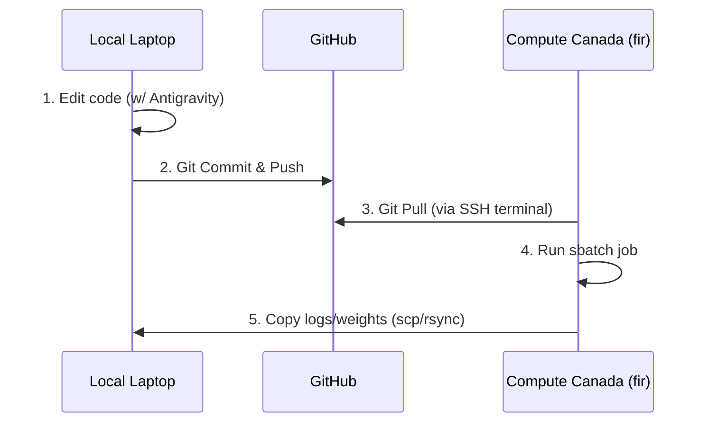

# Antigravity Pair-Programming Workflow

This document explains how to work with the **Antigravity** coding assistant to bridge local development on your laptop and heavy model execution on the Compute Canada / Alliance Canada cluster.

---

## 1. Remote Development Workflow (Recommended)

When you open this repository directly on `fir` using **VS Code Remote - SSH**, the workflow is simplified because we run in the same workspace.

### Step-by-Step Cycle
1. **Open Remote Workspace:** Connect to `fir` in VS Code and open your cloned repository folder `/project/def-mkhoshba/hpai-heterogeneous-gnn-canada`.
2. **Develop with Antigravity:** Ask me to write code, design models, or write script files. I will save files directly on the cluster filesystem.
3. **Execute Job Scripts:** Ask me to launch testing scripts. I can run Slurm jobs using terminal execution:
   ```bash
   sbatch scripts/slurm/hello_compute_canada.slurm
   ```
4. **Monitor Jobs:** Ask me to check the status of jobs running on the cluster:
   ```bash
   squeue -u mkhoshba
   ```
5. **Analyze Logs & Results:** Once the job finishes, I can read the output logs (e.g., `logs/hello_12345.out`), write summaries of metrics, or plot loss curves directly from the remote filesystem.

---

## 2. Local-Remote Hybrid Workflow (Fallback)

If you prefer to edit files locally on your laptop, the workflow requires manual synchronization using Git.

### Step-by-Step Cycle


1. **Local Edits:** Work with me in your local workspace. I edit code locally in `d:/gdrive/models/hpai-heterogeneous-gnn-canada`.
2. **Git Commit & Push:** Push changes to GitHub:
   ```bash
   git add .
   git commit -m "update model architecture"
   git push origin main
   ```
3. **Sync on Cluster:** Open a terminal on `fir` and pull the changes:
   ```bash
   ssh fir
   cd /project/def-mkhoshba/hpai-heterogeneous-gnn-canada
   git pull origin main
   ```
4. **Submit Cluster Job:** Run your training job using Slurm:
    sbatch scripts/slurm/train_model.slurm
5. **Download Outputs:** Retrieve trained weights or loss curves to your local laptop:
   ```bash
   scp mkhoshba@fir.alliancecan.ca:/scratch/mkhoshba/hpai/outputs/metrics.json ./outputs/
   ```

---

## ⚠️ Critical Safety and Privacy Information

> [!CAUTION]
> **NEVER paste confidential authentication materials into the chat.**
> This includes:
> - SSH Private Keys (e.g., contents of your `id_ed25519` key file).
> - Compute Canada / Alliance Canada portal passwords.
> - Google Earth Engine or Google Cloud API service account JSON key tokens.
> - Multi-factor authentication (MFA) codes.
> 
> I will never ask for your password or private key. Always enter passwords and credentials directly into the secure VS Code input prompts, never in our discussion chat.
