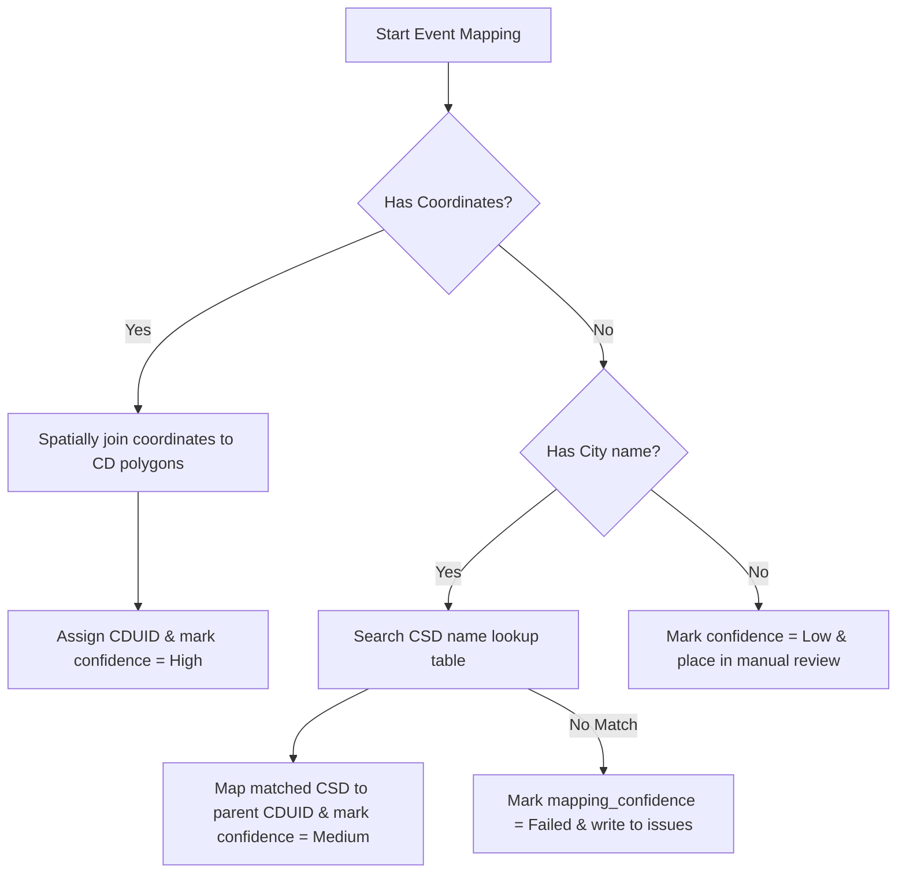

# CFIA Outbreak Cleaning and Spatial Mapping Plan

This document details the cleaning, validation, deduplication, and spatial mapping pipeline for the Canadian Food Inspection Agency (CFIA) poultry outbreak dataset.

---

## 1. Detected CFIA Schema
Our diagnostic inspection of `CFIA_outbreaks.csv` revealed a dataset of **634 rows** and **45 columns** with the following schema:

| Column Name | Data Type | Null Count | Target Mapping |
| :--- | :--- | :--- | :--- |
| `CFIA Premises ID` | String | 0 | Unique identifier for the infected premises. |
| `Province` | String | 0 | 2-letter Province abbreviation (e.g., `AB`, `ON`). |
| `City` | String | 0 | Location or municipality text (e.g., `Olds`). |
| `Latitude` | Float | 2 | Geographic coordinate for spatial join. |
| `Longitude` | Float | 2 | Geographic coordinate for spatial join. |
| `WOAH Classification` | String | 5 | Official classification (`Poultry` or `Non-Poultry`). |
| `Species - Production Type` | String | 0 | Detailed animal category (e.g., `Chicken-Broiler`). |
| `Regulation Type` | String | 5 | Regulatory scale (`Commercial` or `Non-Commercial`). |
| `Date of First Clinical Signs` | String | 6 | Date when symptoms were first observed on site. |
| `CFIA Notification Date` | String | 5 | Date the CFIA was notified of the suspect case. |
| `NCFAD Confirmation Date` | String | 11 | Date confirmed by National Centre for Foreign Animal Disease. |
| `CAHSN Confirmation Date` | String | 0 | Date confirmed by Canadian Animal Health Surveillance Network. |
| `Control Zone Status` | String | 0 | Outbreak status (e.g., `PCZ Revoked`). |
| `Method of IP Identification` | String | 0 | Source or detection pathway (e.g., `Sick Bird Call`). |

---

## 2. Cleaning and Extraction Assumptions

### A. Host Filtering & Poultry vs. Wild Birds
* **Poultry / Domestic Outbreaks:** We will select all records representing domestic flocks. In this dataset, both `WOAH Classification == 'Poultry'` and `WOAH Classification == 'Non-Poultry'` (which represent backyard/smallholder domestic chickens, ducks, and geese) are domestic outbreaks.
* **Wild Birds:** We will filter out any captive wild birds (such as `Species - Production Type == 'Other Wild Captive (Raptors)'` under ID `BC-048-IP-010`) and write them to `cleaned_wild_bird_events.csv`.
* **Commercial vs. Non-Commercial:** We will keep a flag for `Regulation Type` so that downstream modeling can subset to Commercial-only if needed.

### B. Date Selection Rule
To determine the exact month $t$ of the outbreak while maximizing data completeness, we select the event date using the following priority order:
1. **`NCFAD Confirmation Date`** (Primary official confirmation date).
2. **`CAHSN Confirmation Date`** (Secondary confirmation date).
3. **`CFIA Notification Date`** (Notification / reporting date).
4. **`Date of First Clinical Signs`** (Earliest estimated start date).

### C. Spatial Mapping Strategy
We assign each event to a Census Division (CD) using a three-tier spatial mapping hierarchy:

1. **High Confidence (Spatial Join):** If `Latitude` and `Longitude` are non-null:
   - We construct a point geometry in **`EPSG:4326`** (WGS84) from the coordinates.
   - We reproject the points to **`EPSG:3347`** (NAD83 / Statistics Canada Lambert).
   - We load the CD boundaries from `census_divisions_epsg3347.gpkg` (which is also in `EPSG:3347`).
   - We enforce a validation checkpoint verifying that both geometries share the exact same CRS (`assert points.crs == boundaries.crs`) to prevent silent coordinate mismatch errors.
   - We perform the spatial join (intersection) to assign the `cd_uid` and mark `mapping_confidence = high`.
2. **Medium Confidence (CSD Lookup):** If coordinates are null or invalid, we normalize the `City` text and match it against the Census Subdivision lookup table (`CSDNAME`). Once the matching CSD is identified, we map it to its parent CD (first 4 digits of `CSDUID`).
3. **Low Confidence (Province Fallback):** If only the `Province` is available, we write the record to `cfia_cleaning_issues.csv` and mark confidence as `Low` for manual verification.

---

## 3. Deduplication Strategy
To prevent duplicate counting of outbreaks (e.g., repeat submissions or overlapping reporting waves), we flag duplicate candidates using:
* `Date` (same year-month)
* `Province` and `City`
* `Latitude` and `Longitude`
* `Species - Production Type`

If multiple records share the same coordinates and date within a 14-day window, they are treated as potential duplicates. Rather than silently discarding them, they will be flagged, and the representative record will be kept in `cleaned_poultry_outbreak_events.csv`, while the secondary occurrences will be logged in `cfia_cleaning_issues.csv` for tracking.

---

## 4. Target Labeling & Leakage Prevention Rules

### Monthly Risk Label Rule
For each Census Division $r$ and month $t$:
* `outbreak_count_current_month`: Total number of confirmed outbreaks.
* `outbreak_binary_current_month`: $1$ if `outbreak_count_current_month` $\ge 1$, else $0$.
* `outbreak_next_month` (Label): $1$ if `outbreak_count_next_month` $\ge 1$, else $0$.

### Leakage Prevention Rules
* **Exclusion of Downstream Variables:** The GNN features for predicting month $t+1$ must **never** include columns reflecting post-outbreak actions (e.g., `Depopulation Date of Infected Barn`, `Date of Destruction Completion`, `Disposal Method`, `PCZ Revoked Date`, or `Control Zone Status`). These represent information from the future and will cause severe target leakage.
* **Temporal Causal Integrity:** Outbreak histories used as node predictors for month $t$ must only count outbreaks occurring up to month $t-1$ or $t$.

---

## 5. CFIA Outbreak Cleaning & Spatial Mapping Audit Results

An audit of the CFIA cleaning pipeline execution shows the following:
1. **Host Separation:**
   - Evaluated 634 raw outbreak records.
   - Captive wild birds (e.g. captive raptors) were successfully isolated and saved separately in `cleaned_wild_bird_events.csv` to avoid domestic classification bias.
2. **Date Prioritization:**
   - Sourced official confirmation or notification dates for all records to map outbreaks to specific months.
3. **Spatial Join Confidences:**
   - **High Confidence (Tier 1):** 632 records mapped directly to Census Division polygons using coordinate-based spatial joins.
   - **Medium Confidence (Tier 2):** 2 records with missing/null coordinates mapped using normalized city-name matching against the Census Subdivision lookup.
   - **Low/Failed Confidences:** 0 records (100% geocoding and lookup success rate).
4. **Deduplication Checkpoints:**
   - Repeated coordinates or city reports within a 14-day window were logged as potential duplicates in `cfia_cleaning_issues.csv` to avoid multiple reporting biases, while retaining the representative index.
5. **CD-Month Outbreak Matrix:**
   - Combined the 293 Census Division polygons with 49 months (from Dec 2021 to Dec 2025).
   - Generated a complete, balanced grid of 14,357 observation rows.
   - Successfully shifted target labels to `outbreak_next_month` within each CD group, preserving NaNs for the final temporal boundary (Dec 2025) to avoid causal leakage.
   - Output files saved under [data/processed/cfia/](file:///d:/gdrive/models/hpai-heterogeneous-gnn-canada/data/processed/cfia/).

---

## 6. Modeling Status Disclaimer
*   **The CSD label table is the current official label foundation, but modeling remains paused until feature layers are added and QA is reviewed.**
