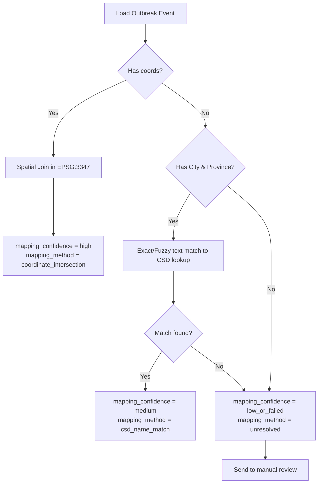

# CFIA Outbreak to Census Subdivision (CSD) Spatial Mapping Plan

This document describes the design, coordinate reprojection policies, name matching rules, and validation checks for mapping poultry outbreak records from the Canadian Food Inspection Agency (CFIA) to Census Subdivisions (CSDs) as the primary graph node scale.

---

## 1. Node Scale Design Decision

### Why CSD is the Primary Node Scale
*   **Localized Epidemiological Risk:** HPAI poultry outbreaks occur at highly localized sites (often within specific sub-municipal watersheds or farm clusters). Mapping events to Census Subdivisions (CSDs) allows spatial graph models to capture fine-grained environmental and traffic contexts (such as local road networks and specific wetlands) that are obscured when aggregated to larger regions.
*   **Direct Ecological Alignment:** CSD boundaries (~5,161 units) align directly with local municipal structures and municipal farm boundaries.

### Why Census Division (CD) remains the Fallback Scale
*   **Sparsity Mitigation:** With only ~577 poultry outbreak events across Canada over 4 years, CSD-level outbreak labels are extremely sparse. If a CSD-level graph network suffers from training difficulties due to sparse labels, we can aggregate features and labels back to Census Divisions (CDs, ~293 units) to improve signal density.
*   **Agricultural Privacy Protections:** While public environmental anomalies and bird checklists are high-resolution, municipal livestock populations are often redacted or suppressed at the CSD level. CDs provide a stable, non-confidential fallback for agricultural livestock density.

---

## 2. Input Datasets

1.  **Cleaned Poultry Outbreak Events:** Sourced from `data/processed/cfia/cleaned_poultry_outbreak_events.csv`. Contains 577 cleaned records with coordinates and location names.
2.  **CSD Boundary Shapefile:** Sourced from `data/raw/boundaries/lcsd000b21a_e.shp`. Contains 5,161 subdivision polygons.
3.  **Census Subdivision Lookup:** Sourced from `data/processed/boundaries/census_subdivision_lookup.csv`. Maps CSD names and unique identifiers.

---

## 3. Coordinate Reference System (CRS) Policy

To guarantee metric area calculations and correct geometric intersections:
*   **GPS/Point Coordinates Ingestion:** Point features (outbreaks) are instantiated in geographic coordinate reference system **`EPSG:4326`** (WGS84).
*   **CSD Vector Analysis:** CSD polygons are analyzed in Statistics Canada's official projected coordinate reference system **`EPSG:3347`** (NAD83 / Statistics Canada Lambert).
*   **Spatial Joins:** All spatial joins are executed under `EPSG:3347`. The script must verify projection consistency and fail loudly if a mismatch is detected.
*   **Web visualization output:** Any geo-files generated for browser-based mapping are reprojected back to `EPSG:4326`.

---

## 4. Mapping Hierarchy & Confidence Definitions

Each outbreak event is mapped to a CSD using a strict priority order:

### Priority 1: Coordinate-Based Mapping (High Confidence)
*   **Method:** Perform a spatial intersection (`sjoin`) between the outbreak coordinate points (reprojected to `EPSG:3347`) and valid CSD polygons.
*   **Confidence:** `high`
*   **Notes:** If a coordinate falls outside the CSD boundaries of its declared province, it is flagged as a spatial anomaly and sent to the manual review issues table.

### Priority 2: Name-Based Mapping (Medium Confidence)
*   **Method:** If coordinates are missing or invalid, match the normalized municipality or city name to CSD names in the lookup database within the same province. 
*   **Confidence:** `medium`
*   **Notes:** Use exact case-insensitive matches first. Fuzzy matching (using Levenshtein distance) is permitted only if the similarity score is above a strict threshold (e.g., 90%) to avoid misallocations.

### Priority 3: Ambiguous Mapping (Low / Failed Confidence)
*   **Method:** If both coordinates and local municipal text names are missing, or if the name matches are ambiguous (matching multiple subdivisions in the same province), do not force a CSD assignment.
*   **Confidence:** `low_or_failed`
*   **Notes:** These records are written to `cfia_csd_mapping_issues.csv` and marked as `unresolved`.

---

## 5. Output Schemas

### 1. `cfia_events_mapped_to_csd.csv`
One row per cleaned poultry outbreak event:
- `event_id`: Unique premises ID.
- `event_date`: prioritized event date.
- `event_month`: prioritized event month (YYYY-MM).
- `original_province`, `original_city`: Declared locations.
- `latitude`, `longitude`: Raw geographic coordinates.
- `csd_uid`: 7-digit CSD code.
- `csd_name`: Name of the matched CSD.
- `cd_uid`: 4-digit parent CD code.
- `cd_name`: Parent CD name.
- `province_code`: 2-digit province ID.
- `province_name`: Province name.
- `mapping_method`: `coordinate_intersection`, `csd_name_match`, or `unresolved`.
- `mapping_confidence`: `high`, `medium`, or `low_or_failed`.
- `mapping_notes`: Auditable notes about matching details or warnings.

### 2. `cfia_csd_mapping_issues.csv`
Contains rows flagged for manual review:
- Missing coordinates or dates.
- Name lookup failures or low-score fuzzy matches.
- Spatial joins where the coordinate-mapped province mismatches the declared text province.
- Duplicate candidates (same premises ID or close spatial proximity within the same month).

---

## 6. Known Limitations & Manual Review Checklist
*   **Coordinate Privacy/Jittering:** Coordinates provided by the CFIA may be jittered or rounded for confidentiality, placing them slightly outside the correct CSD polygon. Coordinates mapping to a different province than declared will be flagged and reviewed.
*   **Duplicate CSD Names:** Certain CSD names are duplicated across provinces (e.g., "Richmond" exists in QC, ON, BC). Name-matching algorithms must strictly partition search keys by province to prevent cross-provincial leakage.

---

## 7. Modeling Status Disclaimer
*   **The CSD label table is the current official label foundation, but modeling remains paused until feature layers are added and QA is reviewed.**
