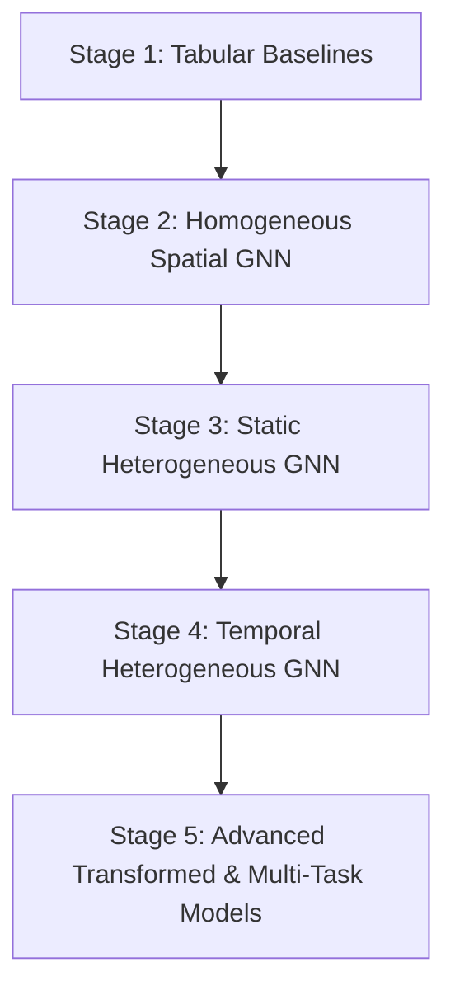

# Project Design: HPAI Heterogeneous GNN Canada

## Scientific Goal
To predict one-month-ahead Highly Pathogenic Avian Influenza (HPAI) outbreak risk in poultry farms across Canadian spatial units by modeling the complex spatiotemporal interactions between wild bird migratory networks, agricultural geography, transport networks, and local environment.

## Primary Prediction Target
* **Target Variable:** $Y_{r, t+1} \in \{0, 1\}$
* **Definition:** A binary label indicating whether at least one CFIA-confirmed poultry HPAI outbreak occurs within region $r$ (defined by our 293 Census Divisions) during month $t+1$.
* **Information Constraint:** The prediction at time $t$ for target $t+1$ must *only* utilize covariates and surveillance data collected up to and including month $t$.
* **Mapping Method:** Each outbreak event is spatially joined to the 293 Census Division polygons based on coordinates (High Confidence). If coordinates are missing, a subdivision text lookup is used to map to the parent Census Division (Medium Confidence). Region-month outbreak statistics are compiled into a tabular label matrix.

## Multi-Layer Heterogeneous Graph Architecture

To capture multi-domain ecological and anthropogenic factors, the graph represents the system as a heterogeneous graph $\mathcal{G} = (\mathcal{V}, \mathcal{E})$ with multiple node types and edge types.

### Node Types ($\mathcal{V}$)
1. **Region Nodes ($V_R$):** Canadian Census Divisions (or Census Agricultural Regions).
2. **Species Nodes ($V_S$):** Key waterfowl/reservoir species (e.g., Mallard, Canada Goose, Snow Goose).
3. **Surveillance Nodes ($V_{W}$, Optional):** Representation of wild bird collection/detection networks.

### Edge Types ($\mathcal{E}$)
1. **Region-Region Spatial Edges ($E_{R \to R}$):** Shared boundaries (adjacency), centroid-to-centroid road distance, or poultry trade connectivity.
2. **Region-Species Ecological Edges ($E_{S \to R}$):** Connects species $s$ to region $r$ in month $t$, weighted by eBird monthly abundance or migration stopover probability.
3. **Region-Surveillance Detections ($E_{W \to R}$):** Represents historical wild bird HPAI detections by CWHC inside that region-month.

---

## Staged Modeling Roadmap

### Stage 1: Tabular Baselines
- Models: Logistic Regression, Random Forest, XGBoost, LightGBM.
- Input: Node-level features aggregated per region-month, ignoring graph topology.

### Stage 2: Homogeneous Spatial GNN
- Models: GCN, GraphSAGE, GAT.
- Input: Region-only graph ($E_{R \to R}$ adjacency edges) carrying static and dynamic environmental features.

### Stage 3: Static Heterogeneous GNN
- Models: Relational GCN (R-GCN), Heterogeneous GraphSAGE (HeteroGraphSAGE).
- Input: Bipartite graph containing region-to-region spatial links and region-to-species abundance links.

### Stage 4: Temporal Heterogeneous GNN
- Architecture: A spatial encoder (HeteroGNN) generates monthly regional embeddings, which are then passed to a sequential model (GRU, LSTM, or Temporal Attention) to forecast the $t+1$ risk.

### Stage 5: Advanced Extensions
- Extensions include Heterogeneous Graph Transformers (HGT), multi-task training (jointly predicting poultry outbreaks and wild bird surveillance detections), and genomic clade-guided edge definitions.

---

## Validation Strategy & Leakage Prevention Rules

To ensure scientific validity and avoid over-optimistic performance metrics, validation must be strictly leakage-aware.

### 1. Temporal & Year-Holdout Validation
* **Temporal Train-Test Split:** Train on years up to $Y-1$, validate on year $Y$, test on year $Y+1$ (e.g., train on 2015–2023, test on 2024–2025). Do not random-shuffle months.
* **Why:** HPAI is highly seasonal and exhibits multi-year cyclical patterns. Shuffling across time creates massive look-ahead leakage.

### 2. Spatial Out-of-Distribution (OOD) Validation
* **Spatial Split:** Hold out entire provinces or agricultural clusters (e.g., train on Eastern Canada, test on Western Canada).
* **Why:** Tests model generalizability to regions with different migratory flyways or poultry densities.

### 3. Leakage Prevention Rules
* **No Look-Ahead Features:** Features for predicting month $t+1$ must rely *exclusively* on information available at or before month $t$. For instance, environmental indices like NDVI or ERA5 climate anomalies must represent month $t$ (or earlier lag months).
* **No Target Leakage in Graph Edges:** If graph edges are constructed using dynamically updating features (e.g., proximity to recent outbreaks), the edges must be computed dynamically for each time step using only historical outbreaks up to month $t$.
* **Strict Separability in Scaling:** Perform min-max scaling or standardization parameters (mean, variance) computation strictly on the training partition and apply them to validation/test partitions.
