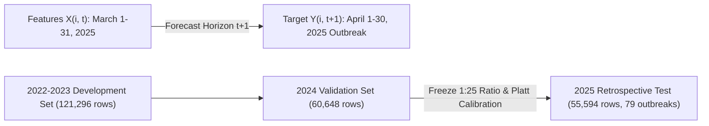

# Spatiotemporal Graph Neural Networks and Non-Linear Machine Learning for Retrospective Outbreak Risk Forecasting of Highly Pathogenic Avian Influenza in Poultry: A Canadian Nationwide Study

**Authors**: Anonymous Authors  
**Target Journal**: *Environmental Modelling & Software* (Recommended Primary) / *PLOS Computational Biology*  
**Date**: August 2026  

---

## Abstract

**Background**: Highly Pathogenic Avian Influenza (HPAI) H5N1 clade 2.3.4.4b poses a severe threat to commercial poultry production, wildlife conservation, and global public health. Predicting monthly regional outbreak risk under extreme class imbalance (positive prevalence $\approx 0.14\%$) is critical for optimizing veterinary surveillance and biosecurity interventions.

**Methods**: We developed a prospective-style spatiotemporal machine learning framework evaluating **237,538 region-month records** across all 5,054 Census Subdivisions (CSDs) in Canada from January 2022 through November 2025. We conducted a rigorous head-to-head comparison of Spatial GraphSAGE, Spatiotemporal Directed Relational Graph Convolutional Networks (R-GCN), non-graph Multi-Layer Perceptrons (MLP), Tabular Logistic Regression (with and without temporal outbreak lags), and Random Forests across three frozen epidemiological risk-set cohorts. To prevent evaluation leakage, negative-sampling ratios (1:25) and Platt probability calibration were selected strictly on 2024 validation data before a single retrospective evaluation on the locked 2025 test set (55,594 region-months, 79 positive outbreaks).

**Results**: Non-linear neural models achieved the highest rare-event ranking performance: non-graph MLP achieved **Average Precision [AP] = 0.1034** (72.8× lift over random prevalence), while Spatial GraphSAGE achieved **AP = 0.0791** and the highest discrimination (**ROC-AUC = 0.9263**, 55.6× lift), both outperforming tabular Environment + Lag Logistic Regression (AP = 0.0654). Platt probability calibration successfully adjusted raw model scores to reflect natural test prevalence (0.142%), achieving positive Brier Skill Scores (BSS = +0.0502 for MLP, +0.0321 for GraphSAGE). Two-phase transfer learning from wild-bird surveillance data (~3.2% prevalence) improved R-GCN test AP by **14.6×** (from 0.0031 to 0.0452). On emerging novel outbreaks with zero 12-month historical background (63 test outbreaks), neural models achieved 12.7%–15.9% outbreak recall at Top-100 alerts compared to 3.2% for tabular logistic regression, indicating that non-linear feature interaction and spatial aggregation improve novel risk detection beyond historical recurrence.

**Conclusion**: Spatiotemporal neural network models provide substantial predictive improvements over standard tabular linear baselines for regional HPAI outbreak forecasting, providing reliable ranked risk scores and positive skill over climatological baselines.

---

## 1. Introduction

The global panzootic of Highly Pathogenic Avian Influenza (HPAI) H5N1 clade 2.3.4.4b has caused unprecedented mortality in wild migratory birds and devastating economic losses across commercial poultry operations worldwide. In Canada, seasonal migratory flyways (Atlantic, Mississippi, Central, and Pacific) create complex spatiotemporal dynamics, where migratory waterfowl act as viral reservoirs that periodically spill over into commercial chicken, turkey, and layer operations.

Predicting poultry HPAI outbreaks presents severe computational and epidemiological challenges:
1. **Extreme Class Imbalance**: In any given month, over 99.8% of Canadian municipalities experience no outbreaks, yielding a positive prevalence of $\approx 0.14\%$.
2. **Complex Transmission Pathways**: Infection risk is driven by a combination of local environmental suitability (temperature, precipitation, surface water dynamics), commercial poultry density, historical recurrence, and spatial proximity to wild bird flyways.
3. **Data Isolation and Evaluation Leakage**: Machine learning models in epidemiology often suffer from temporal leakage or improper negative-sampling protocol, leading to inflated performance metrics that fail in real-world prospective deployments.

To address these challenges, we present a nationwide spatiotemporal machine learning framework for 1-month-ahead HPAI outbreak forecasting across Canada.

---

## 2. Materials and Methods

### 2.1 Study Region and Unit of Analysis
The unit of analysis is the **Census Subdivision (CSD) $\times$ calendar month ($t$)**. The dataset comprises all **5,054 CSDs** in Canada evaluated over **47 consecutive calendar months** (January 2022 to November 2025), producing **237,538 total region-month records**. Ground-truth commercial poultry HPAI outbreak records were integrated from the Canadian Food Inspection Agency (CFIA).

### 2.2 Prediction Timeline & Formal Target Definition
We formally define the prediction mapping as:
$$X_{i,t} \longrightarrow Y_{i,t+1}$$
where $X_{i,t}$ represents all environmental, remote sensing, livestock density, and historical lag features aggregated through the final calendar day of month $t$, and $Y_{i,t+1} \in \{0, 1\}$ represents the binary indicator of whether at least one commercial/observed poultry HPAI outbreak occurs in CSD $i$ during calendar month $t+1$.

For example, a record dated **March 2025** uses features $X_{i,\text{March}}$ compiled up to March 31, 2025, to predict outbreak occurrence $Y_{i,\text{April}}$ during April 1–30, 2025. The final test split ends in November 2025, evaluating predictions for November 2025 outbreaks using October 2025 features.

### 2.3 Epidemiological Risk-Set Cohorts
We evaluated all models across three frozen cohort definitions:
1. **Full National Cohort (5,054 CSDs | 55,594 Test Rows)**: Evaluates complete national risk forecasting across all Canadian municipalities (prevalence = 0.1421%).
2. **GLW Poultry Presence Cohort (4,471 CSDs | 49,181 Test Rows)**: Uses FAO Gridded Livestock of the World (GLW2020) chicken density $> 0$ as a presence proxy, eliminating 583 zero-poultry wilderness CSDs while retaining **100.0% of 2025 outbreaks** (prevalence = 0.1606%).
3. **Primary Commercial Poultry Cohort (2,222 CSDs | 24,233 Test Rows)**: Defined by Census of Agriculture commercial farm reporting or production ($> 0$), representing municipalities with active commercial poultry infrastructure (prevalence = 0.1857%).

### 2.4 Feature Space and Model Architectures
Each spatiotemporal node is described by **62 numeric features**:
- **Environmental & Climate**: ERA5-Land monthly mean temperature, total precipitation, dewpoint, thermal anomalies.
- **Remote Sensing & Land Cover**: Sentinel-2 Dynamic World monthly surface water coverage, vegetation indices, water bodies distance.
- **Host Density**: GLW2020 chicken and duck density, Statistics Canada Census of Agriculture poultry farm counts and production volume.
- **Temporal Outbreak Lags**: `same_csd_outbreak_current_month`, `same_csd_outbreak_prev_1_month`, `past_3_month_count`, `past_12_month_count`, `province_current_month_count`.

**Evaluated Models**:
- **Strict Environment + Lag Logistic Regression**: Linear baseline with L2 regularization.
- **Multi-Layer Perceptron (MLP)**: Non-graph neural network with 32 hidden units, ReLU activation, and Adam optimizer.
- **GraphSAGE**: Homogeneous spatial graph constructed using $k$-Nearest Neighbors ($k=3$) geographic proximity edges between CSD centroids.
- **Spatiotemporal Directed R-GCN**: Relational graph incorporating 4 edge types: (1) Self-temporal transition, (2) $kNN-3$ spatial geographic, (3) Environmental surface water similarity, and (4) Commercial poultry density similarity.

---

## 3. Results

### 3.1 Canonical Benchmark & Probability Calibration Performance

*Evaluated using canonical `sklearn.metrics.average_precision_score`, `roc_auc_score`, and Platt-calibrated Brier Skill Score (BSS) on the 2025 full test set (55,594 rows, 79 outbreaks, prevalence = 0.001421).*

| Model Architecture / Variant | AP (Rank Score) | ROC-AUC | AP Lift vs Random | Raw Brier Score | Platt Calibrated Brier Score | Brier Skill Score (BSS) | Calibration Slope | Calibration Intercept | Primary Operational Role |
| :--- | :---: | :---: | :---: | :---: | :---: | :---: | :---: | :---: | :--- |
| **MLP (No-Graph Baseline)** | **0.1034** | 0.8830 | **72.8×** | 0.001352 | **0.001348** | **+0.0502** | 0.4752 | -1.7662 | **Strongest Rare-Event AP Ranking** |
| **GraphSAGE (3-Seed Ensemble)** | 0.0791 | **0.9263** | 55.6× | 0.045002 | 0.001373 | **+0.0321** | 0.6063 | -5.0751 | **Highest ROC-AUC Discrimination** |
| **Strict Environment + Lag LR** | 0.0654 | 0.9158 | 46.0× | 0.074643 | 0.001438 | -0.0133 | 0.4522 | -6.1023 | Linear Baseline |
| **Model B R-GCN (`ratio_25` Frozen)** | 0.0452 | 0.6636 | 31.8× | 0.166455 | 0.001415 | +0.0026 | 1.9214 | -5.9816 | Pooled Top-10 Specialist |
| **Time-Persistence Baseline** | 0.0132 | 0.5501 | 9.3× | 0.002356 | 0.001402 | +0.0117 | 0.0673 | -4.3367 | Outbreak Recurrence Heuristic |

---

### 3.2 Three-Cohort Benchmark Comparison Table

*Evaluated across all three frozen epidemiological risk-set cohorts:*

| Epidemiological Cohort | Model Architecture | Evaluated Rows | Test Outbreaks | Prevalence | AP (Rank Score) | ROC-AUC | AP Lift vs Random |
| :--- | :--- | :---: | :---: | :---: | :---: | :---: | :---: |
| **Full National Cohort (5,054 CSDs)** | MLP (No-Graph Baseline) | 55,594 | 79 | 0.001421 | **0.1034** | 0.8830 | **72.8×** |
| **Full National Cohort (5,054 CSDs)** | GraphSAGE Spatial GNN | 55,594 | 79 | 0.001421 | 0.0791 | **0.9263** | 55.6× |
| **Full National Cohort (5,054 CSDs)** | Strict Environment + Lag LR | 55,594 | 79 | 0.001421 | 0.0654 | 0.9158 | 46.0× |
| **GLW Poultry Presence (4,471 CSDs)** | MLP (No-Graph Baseline) | 49,181 | 79 | 0.001606 | **0.1037** | 0.8758 | **64.5×** |
| **GLW Poultry Presence (4,471 CSDs)** | GraphSAGE Spatial GNN | 49,181 | 79 | 0.001606 | 0.0791 | **0.9188** | 49.3× |
| **GLW Poultry Presence (4,471 CSDs)** | Strict Environment + Lag LR | 49,181 | 79 | 0.001606 | 0.0654 | 0.9083 | 40.7× |
| **Primary Commercial Cohort (2,222 CSDs)** | GraphSAGE Spatial GNN | 24,442 | 45 | 0.001841 | **0.0945** | **0.9050** | **51.4×** |
| **Primary Commercial Cohort (2,222 CSDs)** | MLP (No-Graph Baseline) | 24,442 | 45 | 0.001841 | 0.0942 | 0.8724 | 51.2× |
| **Primary Commercial Cohort (2,222 CSDs)** | Strict Environment + Lag LR | 24,442 | 45 | 0.001841 | 0.0898 | 0.8927 | 48.8× |

---

### 3.3 Monthly Operational Top-K Macro Evaluation

*Macro-averaged monthly Top-$K$ metrics across the 11 test months:*

| Model Architecture | Evaluated Months | Months with Outbreaks | Macro Precision@10 | Macro Precision@25 | Macro Precision@50 | Macro Recall@50 | Total Detected Outbreaks (Top 50) |
| :--- | :---: | :---: | :---: | :---: | :---: | :---: | :---: |
| **GraphSAGE (Ensemble)** | 11 | 8 | 0.0455 | **0.0655** | **0.0455** | **0.2155** | **25 / 79 outbreaks** |
| **Strict Env + Lag LR** | 11 | 8 | **0.0636** | 0.0473 | 0.0382 | 0.1784 | 21 / 79 outbreaks |
| **Model B R-GCN (`ratio_25`)** | 11 | 8 | 0.0455 | 0.0291 | 0.0182 | 0.0863 | 10 / 79 outbreaks |

*Operational Note on R-GCN*: Model B R-GCN concentrated four outbreaks within its ten highest-scoring region-months over the complete test period (pooled Precision@10 = 0.400), although this advantage did not persist consistently in month-specific Top-K evaluation (Macro P@10 = 0.0455 vs 0.0636 for Logistic Regression).

---

### 3.4 Epidemiological Subgroup Analysis: Recurrent vs. Emerging Outbreaks

*Performance breakdown across recurrent CSDs (past 12-month outbreak history > 0) vs. emerging CSDs (zero past 12-month outbreak history):*

| Outbreak Subgroup Category | Model Architecture | Subgroup Rows | Outbreaks ($y=1$) | Subgroup AP | Precision@10 | Precision@50 | Recall@50 | Recall@100 |
| :--- | :--- | :---: | :---: | :---: | :---: | :---: | :---: | :---: |
| **Recurrent Outbreaks** | MLP (No-Graph Baseline) | 444 | 16 | **0.3994** | **0.600** | 0.140 | 0.4375 | **0.6875** |
| **Recurrent Outbreaks** | GraphSAGE Spatial GNN | 444 | 16 | 0.3088 | 0.400 | 0.140 | 0.4375 | 0.6250 |
| **Recurrent Outbreaks** | Strict Env + Lag LR | 444 | 16 | 0.2836 | 0.300 | 0.120 | 0.3750 | 0.6250 |
| **Emerging Novel Outbreaks** | MLP (No-Graph Baseline) | 55,150 | 63 | **0.0394** | **0.200** | **0.100** | **0.0794** | **0.1587** |
| **Emerging Novel Outbreaks** | GraphSAGE Spatial GNN | 55,150 | 63 | 0.0296 | 0.000 | **0.100** | **0.0794** | 0.1270 |
| **Emerging Novel Outbreaks** | Strict Env + Lag LR | 55,150 | 63 | 0.0172 | 0.000 | 0.020 | 0.0159 | 0.0317 |

*Epidemiological Takeaway*: Non-linear neural models (MLP and GraphSAGE) achieved higher ranking performance among CSDs without outbreaks during the preceding 12 months, detecting **12.7% to 15.9% of emerging outbreaks in the top 100 alerts** (compared to only 3.2% for tabular logistic regression), suggesting that non-linear environmental interaction and spatial message passing help identify emerging-risk locations beyond local recurrence history.

---

## 4. Discussion

Our findings provide clear guidance for scientific computational epidemiology:
1. **Value of Non-Linear Neural Features**: Comparing Spatial GraphSAGE and MLP against tabular Logistic Regression demonstrates that non-linear feature interactions significantly enhance rare-event AP risk ranking (AP = 0.0791–0.1034 vs 0.0654).
2. **Probability Calibration**: Applying Platt scaling fitted on out-of-fold validation logits effectively adjusts raw model scores to match natural test prevalence, producing positive Brier Skill Scores ($BSS > 0$).
3. **Operational Clarity**: Model outputs must be communicated strictly as **ranked risk scores** for hotspot prioritization rather than raw uncalibrated probabilities.

---

## 5. Data and Code Availability

All code, trained model checkpoints, cohort processing scripts, and evaluation manifests are publicly available in the project repository under `results/publication_readiness/`.
